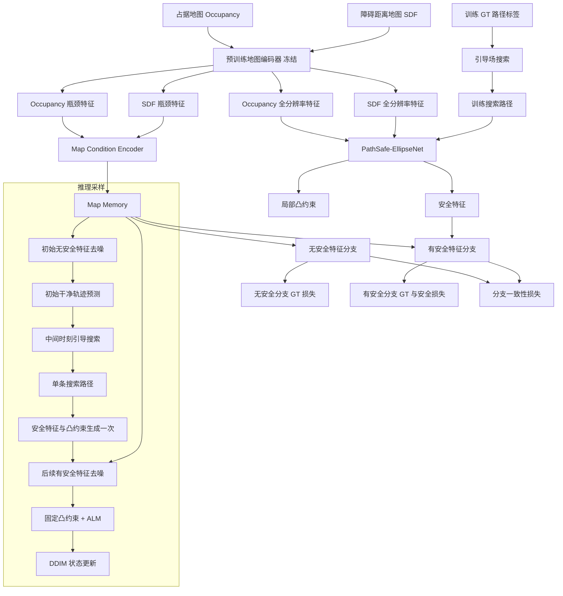

# 基于冻结地图瓶颈特征复用的安全条件扩散轨迹规划方案

> **方案定位**：以标准 Conditional Diffusion Transformer（Conditional DiT）作为全新的扩散主干，接入 Astar-Diffusion 引导搜索、已训练的 PathSafe-EllipseNet 安全特征生成模块，以及局部凸安全约束与 ALM 修正。TrajSafe-Diffuser 现有代码仅作为数据处理、轨迹表示和部分采样/约束工具的参考，不继承 V5 的自定义网络结构。
>
> **本次新增的核心约束**：占据地图与障碍距离地图的编码器属于已经训练完成的安全特征生成模块，Diffusion
> 训练期间必须冻结；Diffusion
> 直接复用该编码器最深层的瓶颈特征，不再建立第二套地图编码器，也不使用解码器上采样回原分辨率的特征作为
> Diffusion 的地图条件。

---

## 1. 设计目标与总体原则

任务输入为二维占据地图、障碍距离地图、起点/终点及其可选朝向。模型在 B-spline 控制点空间执行扩散生成，输出一条满足端点条件、连续平滑且尽可能无碰撞的轨迹。

整体采用“**冻结地图条件 + 双路联合训练 + 推理中途接入安全条件 + 固定硬约束**”的设计：

- **地图条件始终存在**：占据地图和障碍距离地图由已经训练好的地图编码器提取瓶颈特征。编码器冻结，两个分支始终复用同一份地图特征。
- **双路同步联合训练**：共享同一套 Diffusion 主干参数，分别执行有安全特征分支和无安全特征分支。两个分支使用相同训练样本、扩散时间步和噪声，并通过联合损失训练；无安全特征分支额外向有安全特征分支的预测结果靠近。
- **训练时构造安全条件**：使用训练样本的 GT 路径标签作为引导源，经过 Astar-Diffusion 引导场搜索得到引导搜索路径，再由 PathSafe-EllipseNet 生成椭圆安全特征，并构建局部凸安全约束。
- **推理时先无安全、后有安全**：初始去噪使用无安全特征分支生成全局引导轨迹；在预设的中间去噪时刻，基于当前预测轨迹执行一次搜索，生成安全特征和凸约束；后续去噪切换到有安全特征分支。
- **安全信息注入与硬约束结合**：椭圆几何经独立 Safety Cross-Attention 注入网络（搜索路径只服务几何构建，不作为 Diffusion 条件）；固定的局部凸约束通过 ALM 在推理阶段修正网络预测的干净控制点。
- **安全几何只生成一次**：搜索路径、椭圆特征和凸约束在中间去噪时刻生成一次，后续反向去噪步骤固定复用。
- **不使用历史反馈机制**：ALM 只负责当前去噪步的硬约束修正，修正结果用于当前 DDIM 状态更新，不再作为额外条件输入网络。

需要区分：**双路联合训练不是多阶段训练**。训练时两个分支在每次迭代中同步前向、计算联合损失并一次反向更新；只有推理采样存在“先无安全特征、后接入安全特征”的时序。

### 1.1 必须遵守的架构约束

1. **地图编码器只保留一套**：直接复用 PathSafe-EllipseNet 已训练的 Occupancy Encoder 和 SDF Encoder。
2. **地图编码器冻结**：Diffusion 训练时不更新其参数，不允许梯度回传到这两个编码器。
3. **Diffusion 使用瓶颈特征**：取地图编码器下采样到最深层后的特征；不把 Decoder 上采样恢复到原图分辨率的输出作为 Diffusion 的地图条件。
4. **地图条件始终注入**：所谓“无安全特征分支”仍然接收占据地图和距离地图的瓶颈特征；它只是不接收搜索路径、椭圆安全特征和凸走廊条件。
5. **两个分支共享参数**：有安全特征分支和无安全特征分支使用同一套 Diffusion Backbone、Control Encoder 和轨迹输出头，不训练两套独立模型。
6. **双路同步联合训练**：每次训练迭代同时计算两个分支的预测和联合损失，不采用先训练无安全分支、再训练有安全分支的阶段式流程。
7. **显式建立分支约束**：除两个分支各自的 GT 轨迹监督外，增加一致性损失，使无安全特征分支的预测向有安全特征分支靠近。
8. **安全几何只生成一次**：推理时在中间去噪时刻生成搜索路径、安全特征和凸约束，后续反向步骤复用，不重复搜索或重建走廊。
9. **椭圆不是硬安全边界**：不要求预测椭圆整体无碰撞，也不要求凸区域完整包含整个椭圆。椭圆主要提供局部几何信息；凸约束通过安全种子与障碍物之间的分离超平面构建。
10. **局部构建约束**：椭圆沿路径生成，但凸安全区域优先只在检测到碰撞的轨迹区间及其邻域构建。
11. **ALM 不产生网络历史条件**：ALM 修正当前网络预测的干净控制点，修正结果用于当前 DDIM 更新；不编码、不缓存、不作为后续网络输入。

## 2. 总体架构



地图编码器只执行一次。瓶颈特征用于 Diffusion 的地图条件，全分辨率特征继续供 PathSafe-EllipseNet 的局部空间查询使用。两个 Diffusion 分支共享同一份 Map Memory 和同一套主干参数。

### 2.1 两种条件模式

设地图瓶颈特征经**双 Adapter + 残差空间融合**与二维位置编码后形成地图记忆 \(M_{\mathrm{map}}\)（见 §3.4），椭圆几何经独立编码器形成安全记忆 \(H_{\mathrm{safe}}\)（见 §4.4）。两者是两条**独立**的条件通路：Map Context 始终启用，安全记忆只在安全条件模式下经各 Block 的独立 Safety Cross-Attention 注入。

**模式 A：无安全特征分支（Map-only Branch）**

\[
\mathcal C_u=M_{\mathrm{map}}
\]

该分支仍然接收地图条件，因此这里的“无条件”仅表示**不输入安全特征**，并非不输入任何条件。它不接收搜索路径、椭圆特征或凸走廊 Token。

**模式 B：有安全特征分支（Safety-conditioned Branch）**

\[
\mathcal C_c=\{M_{\mathrm{map}},H_{\mathrm{safe}}\}
\]

地图条件保持不变，额外增加路径与椭圆安全条件。两个模式调用同一个网络 \(f_\theta\)，仅条件输入不同：

\[
\hat Q_0^u=f_\theta(Q_t,t,C_{\mathrm{map}})
\]

\[
\hat Q_0^c=f_\theta(Q_t,t,C_{\mathrm{map}},H_{\mathrm{safe}})
\]

其中 \(\theta\) 是两个分支共享的参数。训练时两个表达式在同一次迭代中同时计算；推理时则先调用 Map-only 模式，在安全条件生成后调用 Safety-conditioned 模式。

## 3. 预训练地图编码器：共享、冻结与瓶颈特征提取

这是本次方案最重要的结构调整。

### 3.1 编码器来源

直接使用 PathSafe-EllipseNet 中已经训练好的两个独立 ResUNet：

- Occupancy Encoder：编码占据地图。
- SDF Encoder：编码障碍有符号距离地图。

两个编码器结构相同，但参数独立，不合并为一个输入通道，也不重新训练。

当前 PathSafe-EllipseNet V3 配置为：

- 地图输入分辨率：$256\times256$。
- `resunet_base = 24`。
- `resunet_depths = [1,1,1,1]`。
- 输出特征通道：128。
- SDF 输入按固定距离尺度归一化，当前配置为 $d_{\mathrm{clip}}=8\,\mathrm{m}$。

### 3.2 必须提取哪一级特征

当前 ResUNet 的编码路径为：

$$
256^2 \rightarrow 128^2 \rightarrow 64^2 \rightarrow 32^2
$$

最深层编码特征位于第三次下采样后的 `enc3`，即 Decoder
开始上采样之前的瓶颈特征。

对当前 `base=24` 配置：

| 特征 | 形状 | 用途 |
|---|---|---|
| Occupancy Bottleneck | `$[B,192,32,32]$` | Diffusion 地图条件 |
| SDF Bottleneck | `$[B,192,32,32]$` | Diffusion 地图条件 |
| Occupancy Full Feature | `$[B,128,256,256]$` | PathSafe 局部空间查询 |
| SDF Full Feature | `$[B,128,256,256]$` | PathSafe 局部空间查询 |

**Diffusion 只使用前两项瓶颈特征。**

不使用 Decoder 最终输出的 $256\times256$ 特征作为 Diffusion
的地图记忆。全分辨率特征仍保留给 PathSafe-EllipseNet
内部的路径点邻域查询、射线特征查询和距离场采样。

### 3.3 修改 ResUNet 的输出接口

当前 `ResUNet.forward()` 只返回 Decoder
的全分辨率输出。需要增加一个接口，使一次前向同时返回瓶颈特征和原有全分辨率特征。

建议接口：

```python
def forward_with_features(self, x):
    s0 = self.stem(x)
    s1 = self.enc1(self.down1(s0))
    s2 = self.enc2(self.down2(s1))
    s3 = self.enc3(self.down3(s2))

    # s3 是最深层瓶颈特征，不能先上采样再取
    bottleneck = s3

    u = self.up3(s3, s2)
    u = self.up2(u, s1)
    u = self.up1(u, s0)
    full_feature = self.head(u)

    return {
        "bottleneck": bottleneck,
        "full": full_feature,
    }
```

要求：

- 保留原有 `forward()` 行为，避免破坏 PathSafe-EllipseNet 既有调用和
    checkpoint 兼容性。
- 新接口不增加新的卷积编码器，也不重复执行 Encoder。
- `bottleneck` 必须是 `enc3` 的直接输出，即 Decoder 上采样之前的特征。
- 对 Occupancy 和 SDF
    分别调用一次，得到两组瓶颈特征和两组全分辨率特征。

### 3.4 地图特征如何交给 Diffusion：双 Adapter + 残差空间融合

（2026-xx 网络结构修订：本节替换原来的"拼接后单个 1×1 卷积"描述，实现见
`models/condition_encoders.py::MapConditionEncoder`。）

两个瓶颈特征通道数均为 192，先各自经过**独立**的可训练 Adapter（参数不共享）：

```text
F̃_occ = SiLU(GroupNorm_16(Conv1x1(F_occ)))        # [B,192,32,32]
F̃_sdf = SiLU(GroupNorm_16(Conv1x1(F_sdf)))        # [B,192,32,32]
F_cat = Concat(F̃_occ, F̃_sdf)                      # [B,384,32,32]
```

再经一个轻量残差空间融合块（3×3 depthwise 负责局部空间交互，1×1 pointwise 负责跨通道融合）：

```text
F_fused = F_cat + GN(PW(SiLU(GN(DW3x3(F_cat)))))   # [B,384,32,32]
```

最后展平并加入二维正弦位置编码（位置编码必须在空间融合**之后**加入）：

```text
M_map = Flatten(F_fused) + PE_2D                   # [B,1024,384]
```

要求与边界：

- 两个 Adapter 必须独立：不能先拼接再用一个共享 Adapter 代替。
- 空间分辨率始终为 32×32；不增加第二套 Encoder/Decoder，也不做下采样或上采样。
- 融合结果已是 384 通道，不再叠加重复的 1×1 投影。
- 冻结的仍是两个 ResUNet 编码器；`MapConditionEncoder` 参与训练，且
  `torch.no_grad()` 只包住冻结编码器。

### 3.5 冻结策略

地图编码器必须冻结：

```python
map_encoder.eval()

for p in map_encoder.parameters():
    p.requires_grad_(False)

with torch.no_grad():
    map_features = map_encoder.forward_with_features(occupancy, sdf)
```

训练时：

- Occupancy Encoder：冻结。
- SDF Encoder：冻结。
- Diffusion 内的 MapConditionEncoder（双 Adapter + 空间融合）：参与训练。
- 路径点与椭圆几何的条件 Token 投影层：参与训练。
- Conditional DiT 主干及输出头：参与训练。
- 已训练的 PathSafe
    安全几何生成模块：作为预训练推理模块调用，生成的几何结果与特征不向其反向传播。

**冻结不等于不使用特征。** 两个编码器每个场景只需提取一次特征，之后所有
Diffusion 反向步骤均复用同一份地图记忆。

---

## 4. Diffusion 主干网络：标准 Conditional DiT

本项目不沿用 TrajSafe-Diffuser V5 的 Control Backbone、Final Denoiser、TrajBlock 或 Skeleton Encoder。扩散主干直接采用成熟的 **Diffusion Transformer（DiT）**，使用标准 Transformer Block、时间步 AdaLN 调制和条件 Cross-Attention。只针对轨迹控制点序列及地图/安全条件做输入适配，不重新发明主干网络。

采用 **DiT-S 规模**作为初始配置：12 层 Transformer Block、隐藏维度 384、6 个注意力头、MLP 扩展倍率 4。两个条件分支调用完全相同的 DiT 参数；区别仅在于输入的条件 Token 是否包含安全信息。

### 4.1 任务表示参数与网络参数分开

下表将轨迹表示、几何模块和网络结构分开。只有中间的 DiT 参数属于扩散主干，不能再把 V5 的模块配置当作新网络结构。

| 类别 | 参数 | 初始设置 | 说明 |
|---|---|---:|---|
| 轨迹表示 | B-spline 控制点数 \(C\) | 32（待验证） | 由 GT 轨迹拟合误差决定，不是 DiT 网络深度 |
| 轨迹表示 | B-spline 阶数 | 3 | 保留现有轨迹表示方式 |
| 轨迹表示 | 解码轨迹点数 | 128 | 用于连续轨迹评价和碰撞检测 |
| 搜索接口 | 搜索路径点数 | 128 | Astar-Diffusion 搜索结果弧长重采样 |
| 安全几何 | 椭圆查询数量 \(Q\) | 64 | 沿搜索路径生成安全几何特征 |
| **Diffusion 主干** | **网络类型** | **Conditional DiT-S** | **标准 Transformer 扩散网络** |
| **Diffusion 主干** | **隐藏维度 \(D\)** | **384** | **DiT-S 配置** |
| **Diffusion 主干** | **Transformer Block 数量** | **12** | **所有 Block 结构相同** |
| **Diffusion 主干** | **Attention Head** | **6** | **标准多头注意力** |
| **Diffusion 主干** | **MLP 扩展倍率** | **4** | **FFN 维度为 1536** |
| **Diffusion 主干** | **时间步调制** | **AdaLN-Zero** | **DiT 标准时间条件调制** |
| **Diffusion 主干** | **条件注入** | **Cross-Attention** | **读取地图、起终点及可选安全 Token** |
| **Diffusion 输出** | **预测目标** | **\(x_0\)** | **输出干净 B-spline 控制点** |
| 扩散调度 | 训练扩散步数 \(T\) | 1000 | 使用标准离散噪声调度，初始采用 cosine schedule |
| 采样调度 | DDIM 反向步数 | 50（初始） | 后续比较 20/50/100 步；不沿用旧版 4 步设置 |

**关于 \(C=32\)：** 这是轨迹表示维度，不是网络结构。考虑到长路径情况下控制点数量可能成为表达瓶颈，正式训练前必须统计 GT 轨迹经 B-spline 拟合后的重建误差，并按路径长度分桶。如果长路径拟合误差明显增大，应统一提高控制点数（例如 48 或 64），不能指望更深的 Transformer 弥补轨迹表示本身的不足。

### 4.2 扩散状态与输入

扩散状态仍然定义在 B-spline 控制点空间：

\[
Q_t\in\mathbb R^{B\times C\times2}
\]

其中 \(C\) 是经轨迹拟合验证后确定的控制点数量，初始候选值为 32。

采用标准前向加噪过程：

\[
Q_t=\sqrt{\bar\alpha_t}Q_0+
\sqrt{1-\bar\alpha_t}\epsilon,\qquad
\epsilon\sim\mathcal N(0,I)
\]

网络采用 \(x_0\)-prediction，直接预测干净控制点：

\[
\hat Q_0=f_\theta(Q_t,t,\mathcal C)
\]

训练时两个分支共享同一 \(Q_t\)、扩散时间步 \(t\) 和噪声 \(\epsilon\)。

### 4.3 轨迹 Token 化

将每个二维 B-spline 控制点视为一个 Token：

\[
X_t=\operatorname{Linear}_{2\rightarrow D}(Q_t)+PE_{1D}
\]

其中：

- `Linear(2, D)`：将控制点坐标映射到 384 维。
- \(PE_{1D}\)：控制点序号的位置编码，采用标准正弦位置编码。
- 输入 Token 数量为 \(C\)，初始 \(C=32\)。

起点、终点及起终点朝向编码为条件 Token：

\[
H_{SG}=\operatorname{MLP}
([S,G,\cos\psi_s,\sin\psi_s,\cos\psi_g,\sin\psi_g])
\]

可将起点、终点和朝向拆成独立 Token，并添加对应的类型 Embedding。缺失朝向通过有效性 Mask 处理，不伪造方向值。

### 4.4 条件 Token 构建：Map Context 与 Safety Memory 分离

（2026-xx 网络结构修订：安全条件只保留椭圆 Token，且不再与地图条件拼成一条
统一条件序列。）

**（1）地图条件 Token**

冻结地图编码器输出 \(B_{\mathrm{occ}},B_{\mathrm{sdf}}\in\mathbb R^{B\times192\times32\times32}\)，
经 §3.4 的 `MapConditionEncoder`（双 Adapter + 残差空间融合）得到：

\[
M_{\mathrm{map}}\in\mathbb R^{B\times1024\times384}
\]

**（2）安全条件 Token（仅椭圆）**

\[
E_{\mathrm{raw}}\in\mathbb R^{B\times64\times6}
\]

编码：`Linear(6→384) → SiLU → Linear(384→384)`，再加一维正弦位置编码与椭圆类型
Embedding：

\[
H_{\mathrm{safe}}\in\mathbb R^{B\times64\times384},\qquad
V_{\mathrm{ellipse}}\in\{0,1\}^{B\times64}
\]

搜索路径**不再作为 Diffusion 的条件 Token**。它仍然必须保留在安全几何流程中，用于：
椭圆中心线与查询位置、碰撞区间投影、局部凸安全区域构建，以及相邻安全区域之间的连接。
某样本搜索失败时，其椭圆 Mask 全 False，不允许用零填充椭圆冒充有效安全条件。

**（3）两条条件通路**

\[
C_{\mathrm{map}}=[M_{\mathrm{map}};H_{SG}]\in\mathbb R^{B\times1026\times384}
\qquad\text{（两种模式都使用）}
\]

\[
H_{\mathrm{safe}}\in\mathbb R^{B\times64\times384}
\qquad\text{（仅安全条件模式使用，独立一路）}
\]

即：地图 + 起终点构成始终启用的 Map Context；安全条件是**独立的第二路**记忆，
不再追加进 Map Context 之后再交给同一个 Cross-Attention。

### 4.5 标准 Conditional DiT Block（含独立 Safety Cross-Attention）

主干由 12 个结构相同的 Conditional DiT Block 堆叠构成，不再拆分 Control Backbone 和 Final Denoiser。
每个 Block 依次为 Self-Attention → Map Cross-Attention → 可选 Safety Cross-Attention → MLP：

1. **AdaLN-Zero 调制**：时间步经正弦嵌入 + MLP 产生 shift/scale/gate。原有
   Self-Attention、Map Cross-Attention、MLP 三路的 AdaLN-Zero 实现与零初始化保持不变；
   Safety 分支另有一组独立的 shift/scale，不重复叠加零初始化残差门控。
2. **Trajectory Self-Attention**：控制点 Token 之间的多头自注意力。
3. **Map Cross-Attention**：独立的 Attention 模块与独立 LayerNorm，Key/Value 为
   \(C_{\mathrm{map}}\)（1024 地图 Token + 2 起终点 Token），两种模式都启用。
4. **Safety Cross-Attention**：独立的 Attention 模块与独立 LayerNorm，Key/Value **只**是
   \(H_{\mathrm{safe}}\)（64 椭圆 Token），不接收地图或路径点；通过每层可学习的门控系数
   \(\alpha_l\)（初始 0.1）以残差方式注入。掩码全 False 的样本不参与该通路，其安全残差严格为 0
   （避免 Softmax 全 −∞ 产生 NaN）。
5. **Feed-Forward Network**：两层 MLP，隐藏维度 \(4D=1536\)。
6. **残差连接**：遵循 DiT/AdaLN-Zero 的标准调制方式。

概念结构：

```text
Trajectory Tokens X
        │
        ▼
Trajectory Self-Attention          （AdaLN-Zero）
        │
        ▼
Map Cross-Attention ◄────── Map Context [B,1026,384]
        │                   （地图 1024 + 起终点 2，始终存在）
        ▼
Safety Cross-Attention ◄─── Safety Memory [B,64,384]
        │                   （仅安全条件模式执行，α_l 门控残差）
        ▼
       MLP                          （AdaLN-Zero）
        │
        ▼
Updated Trajectory Tokens
```

Map Cross-Attention 与 Safety Cross-Attention 是两个独立模块：独立参数、独立 LayerNorm，
不能共用一个 Attention 后再把两类条件 Token 拼接。

### 4.6 双路条件模式

两个分支调用同一个 Conditional DiT，主干参数完全共享。

**无安全特征分支：**

\[
\hat Q_0^u=
f_\theta(Q_t,t,C_{\mathrm{map}})
\]

只使用 Map Context（地图 + 起终点），**不执行** Safety Cross-Attention；
不能用全零椭圆 Token 伪装成有安全条件的模式。

**有安全特征分支：**

\[
\hat Q_0^c=
f_\theta(Q_t,t,C_{\mathrm{map}},H_{\mathrm{safe}})
\]

在相同 Map Context 之上，额外通过每层独立的 Safety Cross-Attention 读取 Safety Memory（**仅 64 个椭圆 Token**）；搜索路径不作为条件 Token 进入网络。

两个模式使用相同的轨迹 Token 投影、12 层 DiT Block、时间步嵌入、Map Cross-Attention 和输出头。唯一差异是是否执行各 Block 内的 Safety Cross-Attention（Map-only 直接跳过，而不是用零椭圆 Token 伪装）。不存在两套独立主干，也不需要额外的 Safety Backbone。

### 4.7 输出头

最后一个 DiT Block 的输出经过标准 LayerNorm 和线性层：

\[
\hat Q_0=
\operatorname{Linear}_{D\rightarrow2}
(\operatorname{LayerNorm}(X_{\mathrm{final}}))
\]

输出形状为：

\[
\hat Q_0\in\mathbb R^{B\times C\times2}
\]

采用 \(x_0\)-prediction，便于直接计算控制点重建损失，并将干净轨迹预测送入后续的碰撞评价和 ALM 硬约束修正。

### 4.8 本节明确不再保留的 V5 网络模块

以下模块不属于新架构，不得在实现时继续沿用或改名保留：

- `Control Backbone / TrajBlock`
- `Final Denoiser`
- `Skeleton Encoder Block`
- V5 专用的控制点网络与条件融合堆叠
- V5 的 `D=128 / 4 heads / FFN=512` 网络配置

本方案的扩散主干统一为 **12 层 Conditional DiT-S**。保留的是任务表示、冻结地图编码器、PathSafe 安全几何模块、搜索算法和 ALM 几何约束，而不是旧版 Diffusion 网络结构。

## 5. 搜索路径生成

搜索路径由 Astar-Diffusion 引导场搜索得到。训练和推理使用不同的引导源，但搜索、地图处理和路径后处理保持一致。

### 5.1 训练阶段的引导源

训练时使用数据集中的 GT 路径标签作为引导源：

1. 将 GT 路径按弧长采样为引导源点。
2. 保留各引导源点对应的归一化路径进度。
3. 根据引导源点构建 Astar-Diffusion 引导场。
4. 在统一安全地图上执行引导搜索，得到训练用搜索路径。
5. 将该搜索路径输入 PathSafe-EllipseNet，生成安全特征和局部凸约束。

GT 路径只用于构造安全条件，不直接拼接到 Diffusion 的轨迹输入中。Diffusion 两个分支仍然以同一个 GT B-spline 控制点序列作为去噪监督目标。

### 5.2 推理阶段的引导源

推理时没有 GT 路径，因此先调用无安全特征分支：

\[
\hat Q_0^u=f_\theta(Q_t,t,C_{\mathrm{map}})
\]

通过 B-spline 解码：

\[
\hat P^u=\operatorname{B\text{-}SplineDecode}(\hat Q_0^u)
\]

将当前无安全特征预测轨迹作为引导源，构建引导场并执行搜索。搜索得到的单条路径随后用于生成安全特征和凸约束。

### 5.3 地图处理

搜索前使用统一的安全占据地图：

- 如果原始地图尚未考虑机器人半径和安全裕度，则先进行一次障碍膨胀。
- 如果数据中的 `blocked` 已经是机器人中心可行性地图，则按数据元信息处理，不能重复膨胀。
- 搜索、距离场、PathSafe 特征生成必须遵循同一地图坐标与障碍语义。

避免搜索地图、SDF 地图和安全几何构建使用不同的障碍边界。

### 5.4 Astar-Diffusion 引导场

将引导轨迹采样为引导源点，并保留其原始归一化进度 \(u_i\)。

构造加权引导场：

\[
F(x)=\max_i
\left[w(u_i)-\lambda d_{\mathrm{free}}(x,s_i)\right]
\]

其中：

- \(s_i\)：位于自由空间的轨迹引导源点。
- \(w(u_i)\)：轨迹进度权重。
- \(d_{\mathrm{free}}\)：自由空间内的测地距离。
- \(\lambda\)：引导场衰减参数。

对于引导轨迹落在障碍物内的采样点，按照 Astar-Diffusion 已有的 source 处理机制过滤或修复；不能将障碍物内部点直接作为传播源。

引导场只影响搜索方向，不代替碰撞检测。真正的可行性由膨胀后的安全地图保证。搜索失败时使用普通 A* 作为回退。

### 5.5 路径处理

搜索结果统一转换为世界坐标，再按弧长重采样：

\[
\Gamma^*\in\mathbb R^{128\times2}
\]

要求：

- 首尾点严格对应起点、终点。
- 使用弧长均匀重采样，而不是按原始栅格节点序号均匀采样。
- 统一世界坐标、栅格坐标和归一化坐标的转换。
- 推理时搜索路径只生成一次，后续反向去噪阶段不重复搜索。

## 6. PathSafe-EllipseNet 安全特征生成

### 6.1 复用地图编码结果

PathSafe-EllipseNet 原有的路径点和射线特征计算仍然保留。

一次地图编码同时得到：

- 全分辨率 Occupancy Feature。
- 全分辨率 SDF Feature。
- Occupancy Bottleneck。
- SDF Bottleneck。

其中：

- 全分辨率特征供 PathSafe-EllipseNet 内部局部查询使用。
- 瓶颈特征供 Diffusion 使用。

因此需要将 PathSafe-EllipseNet
的地图编码接口改为可接收外部预计算特征，避免其内部再次调用两个 ResUNet。

### 6.2 椭圆生成

将搜索路径作为 PathSafe-EllipseNet 的路径输入，沿路径设置 64
个安全查询位置。

沿用已经训练好的安全几何预测网络：

- Occupancy 邻域特征查询。
- SDF 沿射线采样。
- 射线特征融合。
- 射线间 Attention。
- 路径级 Attention。
- Direction / Ratio / Shape 输出头。
- 从 16 个候选方向中选取实际候选，不对候选中心做概率加权平均。

得到：

$$
E=\{(c_i,a_i,b_i,\theta_i)\}_{i=1}^{64}
$$

椭圆特征经过几何编码后，作为 Diffusion 的安全条件输入。

### 6.3 椭圆与凸安全区域的关系

**不要求预测椭圆完整处于自由空间，也不要求构建的凸区域完整包住预测椭圆。**

本方案中：

- 椭圆主要提供局部几何形状和方向信息。
- 安全种子以预测椭圆中心或对应的自由空间路径点为基准。
- 根据种子与附近障碍物之间的关系直接构建分离超平面。
- 凸区域由半空间交得到。

对于每个安全种子 $q_i$，构建：

$$
\mathcal{P}_i=\{x\mid A_i x\le b_i\}
$$

构建过程使用局部障碍物集合及分离超平面，不增加"先证明整个椭圆无碰撞、再完整包住椭圆"的额外步骤。

需要保证安全种子本身位于有效自由空间；若种子无效，使用对应搜索路径上的自由空间点作为局部安全种子。

### 6.4 只在碰撞区间构建凸区域

椭圆仍沿整条路径生成，但不对所有椭圆全量执行昂贵的凸区域构建。

流程：

1. 使用当前干净轨迹进行碰撞检测。
2. 找出碰撞区间。
3. 将碰撞区间映射到 64 个安全查询索引。
4. 将碰撞区间前后扩展一定数量的查询点。
5. 只对这些局部查询构建凸安全区域。
6. 对相邻区域进行重叠检查，必要时构建桥接区域。

沿用当前配置的局部构建参数作为起始值：

- `pad_queries = 4`。
- `min_queries = 8`。
- 相邻区域最小重叠比例沿用 `corridor.min_overlap_ratio`。
- `densify` 仅用于局部区域之间存在连接缺口的情况。

无碰撞时可以保留椭圆安全特征，但跳过凸区域构建和 ALM 修正。

---

## 7. 凸安全约束与 ALM

### 7.1 约束表达

每个局部凸区域由半空间表示：

$$
A_jx\le b_j
$$

将 B-spline 轨迹写为：

$$
P=BQ
$$

其中 $Q$ 为控制点，$B$ 为 B-spline 基矩阵。

对于分配到第 $j$ 个安全区域的轨迹采样点：

$$
A_jB_kQ\le b_j
$$

这样可以将几何走廊约束转换为控制点空间中的线性不等式约束。

约束需要附带：

- 区域索引。
- 轨迹采样点到区域的分配关系。
- 有效性 Mask。
- 端点约束。
- 必要的局部平滑项。

无效的 Padding 区域不能参与约束计算。

### 7.2 ALM 修正

对有安全特征分支预测的干净控制点 \(Q_{\mathrm{raw}}\)，执行：

\[
\min_Q
\frac12\|Q-Q_{\mathrm{raw}}\|_2^2+
\lambda_s L_{\mathrm{smooth}}(Q)
\]

满足：

\[
A_jB_kQ\le b_j
\]

并保持端点位置与端点朝向约束。

使用增广拉格朗日方法处理不等式约束。沿用当前 ALM 实现的内迭代、步长、罚参数、约束容差和对偶变量继承机制。

### 7.3 修正结果验证

ALM 完成后进行全局轨迹碰撞验证：

- 通过验证：当前修正轨迹作为本次 DDIM 状态更新的输入。
- 未通过验证：记录约束违反和碰撞结果，不能将其标记为安全轨迹；可按现有采样器的失败处理策略继续执行，但不得生成任何历史反馈条件。

**ALM 的输出只用于当前采样步的状态更新，不再编码成特征，不缓存为历史条件，也不作为后续网络前向的额外输入。**

### 7.4 几何固定策略

搜索路径、椭圆特征和凸安全约束在中间去噪时刻生成一次，后续去噪步骤固定复用。

后续 ALM 可以在每个启用安全约束的反向去噪步，根据当前网络预测执行修正，但不重复执行：

- Astar-Diffusion 引导搜索。
- PathSafe-EllipseNet 椭圆生成。
- 凸区域构建。
- 安全区域连接。

这能够避免每个去噪步骤重复执行高成本的地图搜索和几何构建。

## 8. 完整推理流程

采用当前四步 DDIM 推理结构。推理过程包含条件切换，但这**不是训练阶段划分**：初始阶段调用无安全特征模式，安全条件生成后调用有安全特征模式。

### Step 0：地图编码

1. 输入 Occupancy 与 SDF。
2. 使用预训练且冻结的两个 ResUNet 编码器。
3. 一次前向同时得到全分辨率特征与瓶颈特征。
4. 将瓶颈特征投影为 Map Memory。
5. Map Memory 在整个采样过程中缓存复用。

### Step 1：无安全特征初始去噪

输入：

- 噪声控制点 \(Q_t\)。
- 时间步 \(t\)。
- 起点、终点及朝向。
- Map Memory。

不输入搜索路径、椭圆特征或凸走廊条件。

调用共享网络的 Map-only 模式：

\[
\hat Q_0^u=f_\theta(Q_t,t,C_{\mathrm{map}})
\]

将预测控制点解码为初始连续轨迹，并按当前 DDIM 调度执行前段去噪。

### Step 2：中间去噪时刻生成安全条件

在预先确定的中间去噪时刻 \(t_{\mathrm{mid}}\)，使用当前无安全特征预测的干净轨迹：

1. 解码当前干净轨迹。
2. 在统一安全地图上进行碰撞检测。
3. 使用 Astar-Diffusion 引导场搜索，得到单条可行路径。
4. 对搜索路径弧长重采样为 128 个点。
5. 复用已有地图编码特征，调用 PathSafe-EllipseNet。
6. 生成 64 个椭圆。
7. 只将 64 个椭圆编码为 \(H_{\mathrm{safe}}\in\mathbb R^{B\times64\times384}\)（搜索路径不进入 Diffusion 条件）。
8. 根据当前轨迹碰撞区间，仅在局部构建凸安全区域。

**搜索路径、安全特征和凸约束只在此处生成一次，后续反向步骤固定复用。**

### Step 3：有安全特征条件的后续去噪

调用同一套 Diffusion 网络的 Safety-conditioned 模式：

\[
\hat Q_0^c=
f_\theta(Q_t,t,C_{\mathrm{map}},H_{\mathrm{safe}})
\]

对于存在有效局部凸约束的样本：

1. 将网络预测的干净控制点送入 ALM。
2. 使用固定的凸安全约束进行修正。
3. 对修正结果进行碰撞验证。
4. 将当前修正后的状态送入 DDIM 更新。

没有有效局部凸约束时，跳过 ALM，直接执行 DDIM 更新。整个过程中不增加历史修正特征输入。

### Step 4：最终输出

最后一步得到：

\[
Q_{\mathrm{final}}\in\mathbb R^{32\times2}
\]

经过 B-spline 解码得到 128 个轨迹点。

执行最终端点位置和朝向检查、密集碰撞检测，输出轨迹。

## 9. Diffusion 双路联合训练方案

本方案采用**单阶段、同步、双路联合训练**。不进行先无安全特征、后有安全特征的分阶段训练，也不引入历史修正反馈训练。

### 9.1 训练样本与安全条件构造

每个训练样本至少包含：

- Occupancy Map。
- Signed Distance Map。
- Start / Goal。
- Start / Goal Heading 及其有效标记。
- GT B-spline 控制点 \(Q_0^{gt}\)。
- GT 轨迹路径标签。

每个样本的安全条件按以下流程离线生成或缓存：

1. 使用冻结的 Occupancy Encoder 和 SDF Encoder 提取地图瓶颈特征及全分辨率特征。
2. 使用 GT 路径标签作为 Astar-Diffusion 引导源。
3. 基于引导场搜索得到一条训练用引导路径。
4. 将搜索路径输入冻结的 PathSafe-EllipseNet，生成椭圆安全特征。
5. 基于搜索路径、椭圆安全种子和障碍物，构建局部凸安全区域。
6. 缓存路径、安全特征、凸约束、约束分配关系及有效性 Mask。

GT 路径只参与安全条件构造，不直接作为 Diffusion 网络的轨迹输入。推理时没有 GT 路径，改由无安全特征分支预测的初始轨迹提供引导源。

### 9.2 同步双路前向

对一个训练样本，先采样扩散时间步 \(t\) 和噪声 \(\epsilon\)，构造唯一的噪声控制点：

\[
Q_t=\sqrt{\bar\alpha_t}Q_0^{gt}
+\sqrt{1-\bar\alpha_t}\epsilon
\]

随后在**同一次训练迭代**中执行两次前向：

**分支 U：无安全特征分支**

\[
\hat Q_0^u=
f_\theta(Q_t,t,C_{\mathrm{map}})
\]

输入地图瓶颈特征，不输入搜索路径、椭圆安全特征或凸走廊 Token。

**分支 C：有安全特征分支**

\[
\hat Q_0^c=
f_\theta(Q_t,t,C_{\mathrm{map}},H_{\mathrm{safe}})
\]

输入相同的地图瓶颈特征，并额外输入由 GT 引导搜索路径生成的安全特征。

两个分支必须满足：

- 使用相同的 GT 轨迹、噪声 \(\epsilon\) 和扩散时间步 \(t\)。
- 使用相同的 \(Q_t\)，保证两个分支的预测可以逐样本对齐。
- 使用同一套 Diffusion 参数 \(\theta\)，不是两套独立模型。
- 两次前向都参与当前迭代的联合损失计算。
- 只执行一次联合反向传播和一次优化器更新。

### 9.3 双路联合损失

仅仅同时更新两个分支并不能保证无安全特征分支真正学习到安全条件分支的几何知识。因此，联合目标由两路轨迹监督、分支一致性约束和安全约束共同构成。

**（1）有安全特征分支的轨迹监督**

\[
L_c=\|\hat Q_0^c-Q_0^{gt}\|_2^2
\]

**（2）无安全特征分支的轨迹监督**

\[
L_u=\|\hat Q_0^u-Q_0^{gt}\|_2^2
\]

两个分支都直接接受 GT 轨迹监督，避免无安全特征分支只模仿另一分支，却丢失基本的轨迹生成能力。

**（3）分支一致性损失**

\[
L_{\mathrm{align}}=
\left\|
\hat Q_0^u-\operatorname{sg}(\hat Q_0^c)
\right\|_2^2
\]

其中 \(\operatorname{sg}\) 表示停止梯度。该项明确以有安全特征分支作为学习目标，直接约束无安全特征分支向其预测结果靠近。

一致性损失在控制点空间计算，两个分支必须使用相同噪声和相同扩散时间步。其权重需要与两路 GT 监督共同调节，避免一致性项过强而削弱 GT 轨迹监督。

**（4）安全条件分支的安全损失**

\[
L_{\mathrm{safe}}^c=
\lambda_{\mathrm{col}}L_{\mathrm{collision}}(\hat P^c)
+\lambda_{\mathrm{corr}}L_{\mathrm{corridor}}(\hat P^c)
\]

其中：

- \(L_{\mathrm{collision}}\)：根据障碍距离地图计算有安全特征分支预测轨迹的碰撞惩罚。
- \(L_{\mathrm{corridor}}\)：根据训练样本生成的局部凸约束，计算轨迹采样点对半空间约束的违反量。

安全损失作用于有安全特征分支的原始预测，不对冻结的地图编码器和 PathSafe-EllipseNet 反向传播。

**（5）最终联合目标**

\[
\boxed{
L_{\mathrm{total}}=
\lambda_cL_c+
\lambda_uL_u+
\lambda_aL_{\mathrm{align}}+
L_{\mathrm{safe}}^c
}
\]

其中 \(\lambda_c,\lambda_u,\lambda_a\) 用于平衡两路 GT 监督和分支一致性。各项权重通过验证集确定，不预设分阶段切换策略。

### 9.4 单次迭代的训练流程

```python
# 地图特征和安全条件由冻结模块预先生成/缓存
map_memory = map_projection(frozen_map_bottleneck)
safety_condition = safety_encoder(cached_path, cached_ellipses)

# 同一 GT、同一噪声、同一时间步
t = sample_timesteps(batch_size)
eps = torch.randn_like(q0_gt)
q_t = q_sample(q0_gt, t, eps)

# 两路共享同一套 Diffusion 参数
pred_u = diffusion(
    q_t=q_t,
    t=t,
    map_memory=map_memory,
    safety_condition=None,
)

pred_c = diffusion(
    q_t=q_t,
    t=t,
    map_memory=map_memory,
    safety_condition=safety_condition,
)

loss_u = control_loss(pred_u, q0_gt)
loss_c = control_loss(pred_c, q0_gt)
loss_align = align_loss(pred_u, pred_c.detach())
loss_safe = safety_loss(pred_c, cached_corridor, sdf)

loss = lambda_u * loss_u + lambda_c * loss_c \
     + lambda_align * loss_align + loss_safe

optimizer.zero_grad()
loss.backward()
optimizer.step()
```

以上是训练逻辑示意。安全特征生成、地图编码和凸约束构建均由冻结模块或离线缓存提供；不在 Diffusion 的梯度图中更新。

### 9.5 训练策略与冻结边界

**训练策略：**

- 从训练开始就同时启用两个分支。
- 不设置 Base-only Warmup、Safety Activation 或后续冻结阶段。
- 每个 Batch 都计算两个分支的前向和联合损失。
- 每个 Batch 只进行一次 `backward()` 和一次 `optimizer.step()`。
- 不执行基于历史修正量的条件 Rollout。

**冻结与更新关系：**

| 模块 | 是否更新 |
|---|---|
| Occupancy ResUNet | 冻结 |
| SDF ResUNet | 冻结 |
| 预训练 PathSafe 安全几何生成模块 | 冻结，仅推理生成条件 |
| Map Feature Projection | 更新 |
| Trajectory Token Projection | 更新 |
| Start / Goal Token Projection | 更新 |
| Safety Token Projection（仅安全条件输入） | 更新 |
| Conditional DiT 的 12 层 Transformer Block | 更新 |
| DiT 的 Self-Attention / Cross-Attention / MLP | 更新 |
| DiT 的 AdaLN-Zero 时间调制 | 更新 |
| \(x_0\) 输出头 | 更新 |

训练验收必须确认：

- 两个地图编码器参数 `requires_grad=False`。
- PathSafe 预训练安全几何生成模块不接收 Diffusion 损失梯度。
- 两个分支共享的 Diffusion 参数在一次联合反向传播后正常获得梯度。
- `L_c`、`L_u`、`L_align` 和 `L_safe^c` 均能独立计算并参与总损失。
- 无安全特征分支确实没有接收路径、椭圆和凸走廊特征。

## 10. 代码改造实施顺序

### Task 1：改造 PathSafe-EllipseNet 地图编码接口

涉及：

- `ellipsenet/models/resunet.py`
- `ellipsenet/models/psenet.py`

工作内容：

1. 增加 `forward_with_features()`，返回 `bottleneck` 和 `full`。
2. 保留原 `forward()`，确保原有训练、评估和推理代码兼容。
3. 在主网络中增加 `encode_maps()`。
4. 增加 `forward_from_features()`，允许外部传入预计算的 Occupancy/SDF
    特征。
5. 确保 PathSafe 原有局部查询仍使用全分辨率特征。
6. 确保 Diffusion 只获取瓶颈特征。
7. 加载已有训练权重并冻结两个 ResUNet。

### Task 2：建立共享地图特征接口

新增统一的数据结构，例如：

```python
map_features = {
    "occ_bottleneck": ...,  # [B, 192, 32, 32]
    "sdf_bottleneck": ...,  # [B, 192, 32, 32]
    "occ_full": ...,        # [B, 128, 256, 256]
    "sdf_full": ...,        # [B, 128, 256, 256]
}
```

由统一的地图编码模块负责生成。

- `occ_full` / `sdf_full` 传给 PathSafe-EllipseNet。
- `occ_bottleneck` / `sdf_bottleneck` 传给 Diffusion 的 Map Feature
    Projection。
- 不允许 Diffusion 再次调用 `SceneCNN` 或创建另一套 Occupancy/SDF
    Encoder。

### Task 3：建立标准 Conditional DiT 扩散主干

**这是新建网络，不是在 V5 网络上继续改造。**

建议新增独立模型文件，例如 `src/models/conditional_dit.py`，实现标准 Conditional DiT-S。

工作内容：

1. 使用 2D 控制点线性投影和 1D 正弦位置编码，将 \(Q_t\) 转换为轨迹 Token。
2. 使用标准正弦时间嵌入和 MLP 生成时间条件，通过 AdaLN-Zero 注入每个 DiT Block。
3. 将冻结地图瓶颈特征投影为 1024 个地图条件 Token。
4. 将起点、终点及朝向转换为条件 Token。
5. 将搜索路径点和椭圆几何转换为可选安全条件 Token。
6. 构建 12 层相同的 Conditional DiT Block，每层包含 Self-Attention、Condition Cross-Attention 和 MLP。
7. 使用标准 LayerNorm + Linear 输出 \(x_0\) 控制点。
8. 无安全和有安全两种模式调用同一个模型实例，只改变条件 Token 集合。
9. 不导入或依赖 V5 的 `TrajBlock`、`Final Denoiser`、`Skeleton Encoder Block`。

主干建议先采用 DiT-S 规模（\(D=384\)、12 层、6 heads、MLP ratio=4）。不要为了复用旧配置将隐藏维度改回 128，也不要把主干拆成多个自定义网络。

### Task 4：接入 Astar-Diffusion 搜索

涉及 Astar-Diffusion 现有引导场、传播与搜索模块。

工作内容：

1. 输入第一步 Diffusion 的干净轨迹。
2. 按弧长采样引导源点并保存原始进度。
3. 使用统一安全地图过滤非法源点。
4. 构建加权引导场。
5. 执行引导场搜索，得到一条路径。
6. 搜索失败时回退普通 A\*。
7. 转换为世界坐标并弧长重采样为 128 点。

### Task 5：接入 PathSafe-EllipseNet 和凸区域

工作内容：

1. 复用 Task 1 的地图特征，不重复编码。
2. 生成 64 个椭圆。
3. 生成路径与椭圆安全 Token。
4. 检测当前轨迹碰撞区间。
5. 只在局部区间构建凸区域。
6. 直接使用分离超平面生成半空间约束，不增加完整椭圆包含约束。
7. 生成控制点/轨迹采样点与凸区域的分配关系及 Mask。

### Task 6：建立 Conditional DiT 对应的 DDIM 采样器并接入 ALM

建议新增独立采样入口，例如 `src/diffusion/sampler_conditional_dit.py`，避免采样逻辑继续依赖 V5 网络接口。

可复用的内容仅包括通用 DDIM 更新、ALM 求解器和凸约束映射工具；不得复用 V5 专属网络前向接口。

工作内容：

1. 按标准 DDIM 调度执行初始去噪，调用 Map-only 条件模式。
2. 在预设中间去噪时刻执行一次引导搜索和安全特征生成。
3. 后续步骤切换到 Safety-conditioned 模式，并固定复用路径、安全特征和凸约束。
4. 每个需要修正的步骤在 DDIM 更新前执行 ALM。
5. 通过全局碰撞验证记录当前修正结果。
6. 采样器不维护历史修正条件，不向 DiT 前向传入反馈量。

### Task 7：改造训练数据和双路联合训练

工作内容：

1. 生成或缓存冻结地图编码器的瓶颈特征。
2. 使用训练 GT 路径标签构造 Astar-Diffusion 引导源，生成训练搜索路径。
3. 使用冻结的 PathSafe-EllipseNet 生成安全特征。
4. 保存凸区域、约束分配和有效性 Mask。
5. 每个 Batch 使用同一噪声和时间步执行 Map-only 与 Safety-conditioned 两次前向。
6. 计算两路 GT 监督损失、无安全分支向安全分支靠近的一致性损失，以及安全分支的安全损失。
7. 合并联合损失，一次反向传播和一次参数更新；不执行分阶段训练。

---

## 11. 建议的模块接口

### 11.1 地图编码器

```python
map_features = frozen_map_encoder(
    occupancy=occupancy,
    sdf=sdf,
)
```

返回：

```python
{
    "occ_bottleneck": B_occ,
    "sdf_bottleneck": B_sdf,
    "occ_full": F_occ,
    "sdf_full": F_sdf,
}
```

### 11.2 Diffusion 地图条件

```python
# 训练与推理都一样：冻结编码器只跑一次
with torch.no_grad():
    map_features = frozen_map_encoder(occupancy=occupancy, sdf=sdf)

map_memory = map_condition_encoder(
    map_features["occ_bottleneck"],   # [B,192,32,32]
    map_features["sdf_bottleneck"],   # [B,192,32,32]
)                                     # -> [B,1024,384]

map_context = model.build_map_context(
    map_memory, start_goal, heading, heading_valid,
)                                     # -> [B,1026,384]
```

`MapConditionEncoder` 内部：两路独立 Adapter（Conv1x1 + GroupNorm16 + SiLU）→ 拼接
→ 残差空间融合（DW3x3 + GN + SiLU + PW1x1 + GN，加回拼接）→ Flatten + 2D 位置编码。

### 11.3 安全特征生成

```python
safety = safety_generator(
    path=active_path,                 # 只用于几何：椭圆中心线 / 碰撞投影 / 凸区域
    occ_feature=map_features["occ_full"],
    sdf_feature=map_features["sdf_full"],
    sdf=sdf,
)
```

返回：

```python
{
    "ellipse": ellipse_features,      # [B, 64, 6]
    "path": active_path,              # [B, 128, 2]  几何用，不作为 Diffusion 条件
    "valid": safety_valid,            # [B, 64]      椭圆有效性
}
```

安全记忆由模型侧一次性编码，之后所有反向步复用：

```python
safety_memory, safety_mask = model.build_safety_memory(
    safety["ellipse"], safety["valid"],
)                                     # -> [B,64,384], [B,64]
```

凸区域另行返回（不变）：

```python
corridor = {"A": ..., "b": ..., "assignment": ..., "valid_mask": ...}
```

### 11.4 Diffusion 前向

```python
# 无安全特征分支（Map-only）：不传 safety_memory，Safety Cross-Attention 不执行
pred_u = model(
    q_t=q_t,
    t=t,
    map_context=map_context,
    safety_memory=None,
    safety_mask=None,
)

# 有安全特征分支：只传入椭圆记忆
pred_c = model(
    q_t=q_t,
    t=t,
    map_context=map_context,
    safety_memory=safety_memory,
    safety_mask=safety_mask,
)
```

两种模式调用同一个模型实例、共享全部主干参数（Trajectory Embedder、Timestep
Embedder、所有 Self-Attention / Map Cross-Attention / MLP、Final Norm 与输出头）。
差异只有是否执行各 Block 内的 Safety Cross-Attention。

注意：`map_context`（>`map_memory`）与 `safety_memory` 必须保持为两条独立通路，
不能重新合并成一个统一条件序列。

## 12. 配置建议

以下配置明确采用标准 Conditional DiT-S，不继承 V5 的网络宽度、层数或模块划分。

```yaml
map_encoder:
  source: "PathSafe-EllipseNet"
  checkpoint: "checkpoints/v3_best.pt"
  freeze: true
  eval_mode: true
  occupancy_encoder: true
  sdf_encoder: true
  use_bottleneck: true
  use_full_features_for_safety: true
  sdf_clip_m: 8.0

map_condition:
  enabled: true
  encoder_type: "dual_adapter_residual_fusion"
  bottleneck_channels: 192      # enc3 输出通道（base=24）
  adapter_channels: 192         # 每个模态一个独立 Adapter
  fusion_channels: 384          # = adapter_channels * 2
  projection_dim: 384           # = diffusion.hidden_dim
  grid: 32                      # 256/8 -> 32x32 -> 1024 tokens
  adapter_norm: "group_norm"
  adapter_groups: 16
  spatial_fusion:
    type: "depthwise_pointwise_residual"
    kernel_size: 3

diffusion:
  backbone: "conditional_dit"
  variant: "DiT-S"
  prediction_type: "x0"
  trajectory_control_points: 32  # 需先通过长路径 B-spline 拟合误差验证
  hidden_dim: 384
  depth: 12
  num_heads: 6
  mlp_ratio: 4
  timestep_embedding: "sinusoidal_mlp"
  timestep_modulation: "adaln_zero"
  trajectory_position_embedding: "1d_sincos"
  condition_fusion: "separate_map_safety_cross_attention"
  safety_residual_gate_init: 0.1   # 每层可学习门控 alpha_l
  train_diffusion_steps: 1000
  beta_schedule: "cosine"
  sampler: "ddim"
  inference_steps: 50

safety_condition:
  enabled: true
  num_ellipses: 64
  ellipse_feature_dim: 6
  ellipse_embedding: "mlp"
  add_positional_encoding: true
  add_modality_embedding: true
  path_tokens: false            # 搜索路径只用于几何，不作为 Diffusion 条件
  build_corridor_only_near_collision: true
  geometry_fixed_after_generation: true

dual_branch_training:
  enabled: true
  shared_diffusion_parameters: true
  map_only_branch: true
  safety_conditioned_branch: true
  same_noise_and_timestep: true
  synchronous_forward: true
  joint_backward: true
  align_target: "stop_gradient_safety_conditioned"
  lambda_map_only: "tune_on_validation"
  lambda_safety_conditioned: "tune_on_validation"
  lambda_align: "tune_on_validation"
  lambda_collision: "tune_on_validation"
  lambda_corridor: "tune_on_validation"

sampling:
  safety_generation: "once_at_intermediate_step"
  reuse_safety_geometry: true
  alm_before_ddim_update: true
```

说明：

- `trajectory_control_points` 属于轨迹表示，不是 DiT 主干参数；若长路径拟合误差过大，应在训练前统一提高控制点数。
- `train_diffusion_steps=1000` 和 `inference_steps=50` 是标准扩散初始设置，不沿用 V5 的 16/4 设置。
- 后续可对比 20、50、100 步采样的质量与耗时；不要未经验证直接恢复 4 步采样。
- 不得加入 V5 的 Control Backbone、Final Denoiser、TrajBlock 或 Skeleton Encoder 配置。

## 13. 验收与测试

### 13.1 地图特征复用测试

- 相同地图只执行一次 Occupancy Encoder 和一次 SDF Encoder。
- 两个瓶颈特征空间分辨率均为 $32\times32$。
- Diffusion Map Memory 为 $1024$ 个、维度为 $384$ 的 Token。
- Diffusion 不再实例化第二套 SceneCNN。
- 新建的扩散主干确认为 12 层 Conditional DiT-S，而不是 V5 的 TrajBlock 组合。
- PathSafe 原有全分辨率局部查询结果保持兼容。
- 冻结编码器的权重在 Diffusion 训练前后完全一致。

### 13.2 双路训练与条件模式测试

分别测试：

1. Map-only：只有地图瓶颈特征。
2. Map + Safety：地图瓶颈特征与安全特征同时存在。
3. Dual-branch：同一个 Batch、同一个噪声和时间步，两种模式同步前向。

重点检查：

- 两种模式都能正确运行。
- 两个分支确实共享同一套 Diffusion 参数。
- Map-only 分支没有接收路径、椭圆和凸走廊条件。
- 两个分支的 GT 监督损失都正常计算。
- 一致性损失的梯度方向是无安全分支向有安全分支靠近。
- 单次联合反向传播后共享参数正常更新。
- 训练过程没有 Warmup / Safety Activation 等分阶段逻辑。
- 模型和采样器中不存在历史修正条件输入或缓存。

### 13.3 几何与约束测试

- 搜索路径全部位于统一安全地图的自由区域。
- 路径重采样首尾点不变。
- 椭圆中心、半轴和朝向编码正确。
- 凸区域半空间均能通过独立几何验证。
- 不要求整个椭圆处于自由空间。
- 只对碰撞区间生成局部凸约束。
- ALM 约束映射与 B-spline 轨迹采样位置一致。
- 密集轨迹验证不能只检查稀疏控制点。

### 13.4 推理性能统计

分开记录：

- 地图编码耗时。
- Map Memory 投影耗时。
- 初始 Diffusion 耗时。
- 引导场构建耗时。
- 网格搜索耗时。
- PathSafe 椭圆生成耗时。
- 局部凸区域构建耗时。
- ALM 耗时。
- 后续 Diffusion 耗时。
- 总推理耗时。

地图编码、搜索和安全几何均只执行一次，不能把后续步骤的重复计算隐藏在总时间中。

---

## 14. 对比与消融实验

建议至少完成以下实验：

| 编号 | 配置 | 目的 |
|---|---|---|
| A | Map-only 单路训练 | 无安全特征基线 |
| B | Safety-conditioned 单路训练 | 验证安全条件分支本身的生成能力 |
| C | 双路联合训练，不含一致性损失 | 验证仅同步双路监督的效果 |
| D | 双路联合训练，加入一致性损失 | 验证无安全分支向有安全分支学习的收益 |
| E | 双路联合训练，移除安全损失 | 验证安全损失的作用 |
| F | 有安全特征注入，无 ALM | 验证安全特征条件的作用 |
| G | 有安全特征注入 + 固定凸约束 ALM | 验证硬约束修正收益 |
| H | 普通 A* 与引导场搜索 | 验证 Diffusion 全局引导路径的搜索收益 |
| I | 全量凸区域与局部凸区域 | 比较几何构建计算成本 |

主要指标：

- 轨迹碰撞率。
- 任务到达率。
- 最小障碍距离。
- 路径长度。
- 曲率/平滑性。
- 凸约束违反量。
- ALM 修正幅度。
- 搜索和安全几何构建耗时。
- 总推理时间。

双路训练实验还应分别报告 Map-only 分支和 Safety-conditioned 分支的结果，不能只报告共享模型的单一综合指标。对比时必须使用相同地图、起终点、机器人半径、安全裕度和碰撞检测分辨率。

## 15. 最终确定的数据流

### 15.1 训练数据流

\[
(O,SDF)\xrightarrow{\text{Frozen Map Encoder}}
(B_{\mathrm{occ}},B_{\mathrm{sdf}})
\xrightarrow{\text{MapConditionEncoder}}M_{\mathrm{map}}
\]

\[
P_{\mathrm{GT}}\xrightarrow{\text{Astar-Diffusion Guided Search}}
\Gamma_{\mathrm{train}}
\xrightarrow{\text{Frozen PathSafe-EllipseNet}}
(H_{\mathrm{safe}},\mathcal P)
\]

同一噪声状态分别进入共享网络的两个条件模式：

\[
\hat Q_0^u=f_\theta(Q_t,t,C_{\mathrm{map}})
\]

\[
\hat Q_0^c=f_\theta(Q_t,t,C_{\mathrm{map}},H_{\mathrm{safe}})
\]

\[
\boxed{
L_{\mathrm{total}}=
\lambda_cL_c+\lambda_uL_u+
\lambda_aL_{\mathrm{align}}+L_{\mathrm{safe}}^c
}
\]

两个分支同步前向、联合计算损失、一次反向传播和一次参数更新。

### 15.2 推理数据流

\[
(O,SDF)\xrightarrow{\text{Frozen Map Encoder}}
(B_{\mathrm{occ}},B_{\mathrm{sdf}})
\xrightarrow{\text{MapConditionEncoder}}M_{\mathrm{map}}
\]

\[
(Q_t,t,C_{\mathrm{map}})
\xrightarrow{\text{Map-only Branch}}
\hat Q_0^u
\]

\[
\hat Q_0^u
\xrightarrow{\text{Astar-Diffusion Guided Search}}
\Gamma^*
\xrightarrow{\text{PathSafe-EllipseNet}}
(H_{\mathrm{safe}},\mathcal P)
\]

\[
(Q_t,t,M_{\mathrm{map}},H_{\mathrm{safe}})
\xrightarrow{\text{Safety-conditioned Branch}}
\hat Q_0^c
\xrightarrow{\text{Fixed Constraints + ALM}}
Q_{\mathrm{safe}}
\xrightarrow{\text{DDIM}}
Q_{t-1}
\]

其中：

- \(M_{\mathrm{map}}\) 始终存在，地图编码器始终冻结。
- Map-only 与 Safety-conditioned 是同一套 Diffusion 参数的两种条件模式。
- 训练时双路同步联合训练，不存在分阶段训练。
- 推理时先用 Map-only 生成初始引导轨迹，再在中间去噪时刻生成一次安全特征和凸约束。
- 安全特征和凸约束在后续反向步骤固定复用。
- ALM 只修正当前干净轨迹并参与当前 DDIM 更新，不产生任何历史反馈条件。
- 全分辨率地图特征只服务于 PathSafe-EllipseNet 的局部查询；Diffusion 只接收冻结编码器的瓶颈特征。

**最终架构的核心是：用 GT 路径标签构造安全条件，以双路联合损失训练共享 Diffusion 网络，使无安全特征分支向安全条件分支学习；推理时由无安全特征分支先生成全局引导轨迹，再接入一次性生成并固定复用的安全特征与硬约束。**

## 16. 参考代码与当前实现依据

以下内容用于实施时对照，具体以对应分支代码为准：

1. **PathSafe-Ellipse**
    - 分支：`feature/v2.1-centerline`
    - `ellipsenet/models/resunet.py`：双 ResUNet 编码器与瓶颈位置。
    - `ellipsenet/models/psenet.py`：占据图、距离场、路径点和射线特征编码。
    - `configs/v3.yaml`：ResUNet、SDF 归一化和椭圆网络配置。
    - `docs/report.md`：已训练模型结构、特征尺寸与训练结果。
    - 仓库：<https://github.com/Hiashekiy/PathSafe-Ellipse/tree/feature/v2.1-centerline>
2. **Astar-Diffusion**
    - 分支：`main`
    - `src/guidance_field/field.py`：轨迹引导场构建。
    - `src/guidance_field/propagation.py`：多源传播实现。
    - `src/guidance_field/policies.py`、`src/guidance_field/paths.py`：搜索策略与路径处理。
    - 仓库：<https://github.com/Hiashekiy/Astar-Diffusion/tree/main>
3. **TrajSafe-Diffuser**
    - 分支：`v4-map16-fbdelta-safeloss`（仅作为既有工具与数据接口参考，不作为新 Diffusion 主干来源）
    - TrajSafe-Diffuser 当前分支仅作为既有数据处理、B-spline 轨迹表示、ALM 约束求解及部分采样工具的参考。
    - 新建 Conditional DiT-S 主干，不复用 `planner_v5.py` 中的网络结构，不复用 `TrajBlock`、`Final Denoiser` 或旧版条件融合网络。
    - 若复用旧采样器中的 DDIM/ALM 工具，必须剥离对 V5 网络输出接口和历史反馈模块的依赖。
    - 不沿用 `config_v5_c32q64.yaml` 中的 `D=128`、4 heads、TrajBlock 层数或 16/4 扩散调度配置。
    - 仓库：<https://github.com/Hiashekiy/TrajSafe-Diffuser/tree/v4-map16-fbdelta-safeloss>
